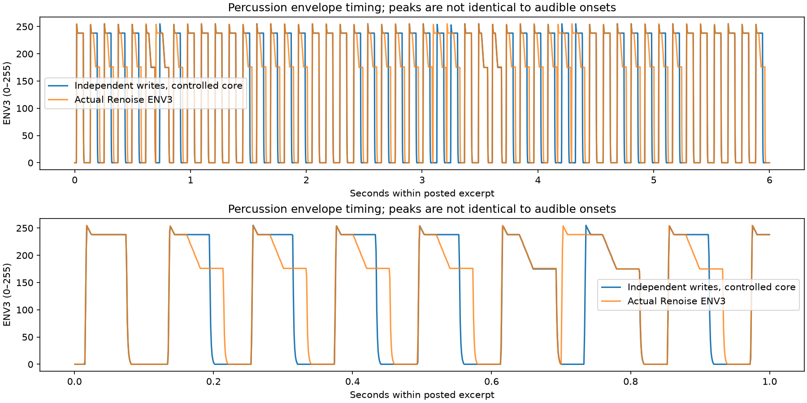

> Follow-up: the robust correction is implemented in CLI 0.3.0 / SIDSynth 0.6.0.
> See [ENVELOPE_TIMING.md](ENVELOPE_TIMING.md) and step-4 evidence. The user
> confirms the reported passage sounds fixed. Earlier measurements below remain
> historical; preliminary large-buffer ENV3 timestamps were corrected in step 4.

# Independent playback comparison — step 3

17 November 2026. **Comparison tooling is implemented; full fidelity is not
approved.** The user hears off percussion in the six-second Alibi excerpt
starting at source time **59.75 s**. Focused real-processor observations reproduce
an envelope peak about **33 ms early** near excerpt time **0.70 s**. The next
milestone is a robust envelope-ordering/timing correction, with this regression.

## Independent reference and reproducibility

`bin/sid2xrns-compare` **0.1.0** is an optional analysis CLI, separate from the
standard-library converter **0.2.1**. Its commands are `reference`, `writes`,
`target` and `audio`. Python analysis uses pinned installed NumPy **2.5.4**,
SciPy **1.18.1** and Matplotlib **3.11.2**. No package was installed or downloaded.
The converter's runtime and parameter/state contract are unchanged.

The independent reference is installed **VICE VSID 3.10**, Arch package
**vice 3.10-3**, with its own CPU, PSID interrupt driver and **reSID** engine.
The exporter uses ChiptuneSAK execution; SIDSynth uses **libresidfp 1.3.0**.
[reference-lock.json](reference-lock.json) pins the VSID executable and the local
ROM hashes, plus analysis package versions. Executable/ROM changes fail the
reference lock. Audio analysis checks its package versions. The installed
package's GPL-2.0-only metadata/license are retained under `third_party/vice/`;
no VICE executable, ROM, external SID music or full music recording is bundled.

VICE loads the original SID; it does not replay an exporter capture. A monitor
trace records CPU cycles and play entries. The `dump` sound device records
ordered register values and cycle deltas. Every dump write is paired with its
monitor store address and a checked constant sound/CPU clock offset. A separate
silent ALSA `null`/WAV pass must produce the same CPU timeline. Invalid runs,
buffer errors, count/order differences and short recordings fail explicitly.
The source window is cropped by counted play entries, not detected song endings.

The original synthetic reference repeats with byte-identical WAV, ordered writes
and play entries. This checks repeatability; it does not make reSID and reSIDfp
sample-identical or prove arbitrary C64 compatibility.

## Recorded results

**Automated by the agent:** 36 Python tests pass. The diagnostic self-check
verifies sample-identical processor audio, matching registers, release ownership
and physical SID writes at MIDI offsets 13/47. No new complete callback allocation/
mutex audit, sanitizer run or general VST3 validation is claimed.

| Original SID / explicit window | Independent ordered play-write matches | Mismatched calls |
| --- | ---: | ---: |
| Existing synthetic, 520 calls | 48 | 0 |
| New known-event `fixtures/fidelity.sid`, 240 calls | 27 | 0 |
| Alibi, 12000 calls / 239.403683 s | 287977 | 0 |
| Turrican 3, subsong 2 / 8580, 1200 calls | 20400 | 0 |

Alibi's matched source writes differ in timing by at most about **1.015 us**
against VICE, after aligning the first play entry. VICE's interrupt/VIC scheduling
and the fixed-call profile are reported separately. Comparisons cover play
writes; VICE driver/init writes remain retained, without an init-equivalence claim.

**Actual Renoise 3.5.4 Demo, automated by the agent:** at 48 kHz / actual 1024
device frames, the installed SIDSynth plays the explicit full Alibi window.
The recording has complete **239.4036875-s** comparison coverage, equal stereo,
unclipped audio and silence around transport; all 67 effective initial values,
aliases/channels pass. The 241-s transport take includes a later song wrap;
analysis keeps only the requested reference window. The diagnostic separately
captures the full first forward pass: **102321** physical writes and **48390**
register-replay block checks, zero overflow. Native callback sizes differ from
the device buffer size.

The reported excerpt is also reached by playing from the beginning at actual
256 device frames. Its **2860** physical writes over 59.75–65.75 s have identical
sample timestamps and values at both device sizes. A later verified diagnostic
adds non-mutating ENV3 and actual SID-cycle readback at chunks of at most 48
output samples. Splitting those pulls passes the sample-identical audio check.

The new synthetic exercise contains three MIDI-owned parts, releasing pitch,
noise/tonal percussion and filter changes. Actual host playback detects all five
intentional faults: missing arp step, frozen release tuning, delayed attacks,
changed waveform and changed filter. The octave note edit changes only voice-2
frequency among measured register fields, approximately 2228 → 4455, within
mapping quantization. All seven correct/fault/edit audio takes are sample-identical
between the tested 1024/256 device settings. The unchanged correct case also
repeats sample-identically. Fault audio is compared to correct actual-host audio,
so cross-emulator timbre is not the fault detector's oracle.

## Audio measurement and listening

`audio` reports one bounded global recording offset from 1-ms RMS-envelope-change
correlation. Local offsets are diagnostics only. It reports coverage, raw level
difference, waveform residual/correlation, half-second magnitude distances and
worst timestamps. There is no variable time warping or single fidelity pass score.
Short results expose missing coverage; silent/nonfinite inputs and sample-rate
differences are rejected. Spectrograms, level-matched A/B and difference WAVs
are written beside the report. Waveform residuals include oscillator phase effects.

The full installed-plugin Alibi recording aligns approximately **0.298 s** after
the independent reference. Checked beginning/middle/end passages have zero
additional detected lag at the tool's 1-ms resolution. This coarse result does
**not** rule out individual off hits. The initial largest half-second spectral
distance is near **62.5 s**; six-second clips begin at 0, 59.75, 43.75 and 65.25 s.
The installed output is about **16.82 dB** below VICE before level matching.
About **6 dB** also separates the diagnostic's internal processor output from
the installed plugin recorded through the native song's mixer. These levels are
reported, not silently removed from the raw measurements.

**User listening:** the user identifies three off percussion hits in the posted
59.75–65.75-s excerpt, the first before excerpt second 1, apparently early. They
clarify that percussion placement/shape is the concern, rather than identical
timbre. This is a failed fidelity check, not listening approval. No full-window
listening assessment is claimed.

## Focused percussion regression

At source time **60.449987 s** (excerpt **0.699987 s**), voice 3 starts a
TEST/gate percussion sequence. The source's Sustain/Release write precedes that
gate by **13 CPU cycles**, approximately **13.2 us**. The original exporter rounds
both to native unit **773760** (60.45 s); the source's ordering/gap is lost.
The actual envelope peak is **60.452938 s**, compared with **60.485771 s** in a
controlled same-core source replay: **32.834 ms early**. Envelope peaks are not
identical to audible attack times. Five large ENV3 peak deviations are measured
in this excerpt; that is distinct from the user's three perceived off hits.



The controlled replay uses the independent VICE writes, chronological cycle
clocking and the pinned raw SID core. A second replay uses actual physical host
writes at measured cumulative chip cycles. It reproduces actual ENV3 with mean
absolute error **0.281** on the 0–255 scale; **98.65%** of observations are within
three units, with up-to-1-ms envelope sampling on steep edges. Holding the actual
clock fixed and substituting the source SR write schedule restores the first
expected peak. Substituting only voice-3 waveform/gate control writes does not.
This isolates SR scheduling/order as a cause in the controlled regression;
the roughly 33-ms jump is consistent with the pinned SID's 15-bit ADSR rate
counter delay. It is not evidence that every percussion difference has one cause.

Actual cycle readback is about **985033.57 chip cycles per audio second**, versus
the nominal PAL 985248. The pinned two-pass sinc resampler truncates two 10-bit
cycle/sample ratios: its effective cycle-clock output is about **48010.446 Hz**
when configured for 48000 Hz. Raw cycle-clock WAVs must account for that known
rate; `render_core_reference.py` explicitly converts the fixed clock with linear
interpolation. Its envelope logs use CPU cycles directly. This additional phase
factor is recorded; no core/resampler correction has been made.

An **experimental scratch-only guard** moves a changed ADSR point one native unit
(78.125 us) earlier when it precedes an owned gate-on but rounds to the same unit.
It moves 2507 Alibi points, leaving note rows unchanged. At 256 frames it repairs
the reported peak (error **+0.562 ms**) and removes the original large deviations
in the excerpt, but creates another early peak near excerpt **0.580 s**. It is
**not adopted** in the converter or synth. Its helper and tests remain under the
optional fidelity tools to reproduce/falsify this candidate. Blindly nudging
points is not a validated general solution.

## Reproduce

Run from `/home/dragos/work/SID2XRNS`, choosing fresh output paths/profile labels.
The following are the exact commands used for the main results; existing output
directories are retained and cannot be overwritten by the comparison CLI.

```sh
./bin/sid2xrns-compare reference /home/dragos/work/Alibi-Renoise/Alibi.sid \
  --play-calls 12000 -o work/fidelity/alibi-reference
./bin/sid2xrns-compare writes work/fidelity/alibi-reference/reference.json \
  work/alibi-cli-window.capture.jsonl.gz -o work/fidelity/alibi-source-writes.json
./bin/sid2xrns-compare audio work/fidelity/alibi-reference/reference.wav \
  work/fidelity-alibi-product.wav -o work/fidelity/alibi-audio
./bin/sid2xrns-compare target work/fidelity-alibi-probe.json \
  work/fidelity/alibi-reference/reference.json -o work/fidelity/alibi-target-pass1.json
python3 tools/make_fidelity_cases.py work/fidelity/cases
python3 -m unittest discover -s tests -v
cmake --build work/build --target SIDXRNSTimingProbe_VST3 probe_self_check --parallel 4
work/build/probe_self_check
```

The existing guarded host runner is used, with copied preferences/ReMCP and only
scratch songs under `work/`. For the full installed-product take:

```sh
cp work/alibi-cli-window.xrns work/fidelity-alibi-product.xrns
python3 probe/host.py launch \
  --config /home/dragos/work/SIDSynth/work/midi-import/config/Renoise/V3.5.4/Config.xml \
  --remcp /home/dragos/work/SIDSynth/work/midi-import/config/Renoise/V3.5.4/Scripts/Tools/com.renoise.ReMCP.xrnx \
  --label fidelity-product1024 --quantum 1024 --song fidelity-alibi-product.xrns \
  --plugin-dir /home/dragos/work/SID2XRNS/work/product-plugins
python3 probe/product_check.py --name fidelity-alibi-product --seconds 241
python3 probe/close_host.py
```

The full diagnostic uses `fidelity-probe1024`, `--capture-seconds 260`, the
combined scratch scan directory `work/fidelity-plugins`, and the CLI's existing
`export --diagnostic` output `work/fidelity-alibi-probe.xrns`. Capture:
`python3 probe/host.py capture --name fidelity-alibi-probe --seconds 241`.
The later 256 profiles use `--capture-seconds 90` and 67-s takes from the start.
`tools/run_fidelity_cases.py --label cases1024` and `--label cases256` load the
seven generated scratch songs and measure first forward passes. The runner
requires those generated songs copied to simple `work/fidelity-*-probe.xrns`
names; it guards the selected PID and private profile.

Build the optional controlled-core renderer from existing pinned local products:

```sh
c++ -std=c++17 -O2 \
  -I /home/dragos/work/SIDSynth/build-clean/_deps/libresidfp-build/realtime-src \
  -I /home/dragos/work/SIDSynth/build-clean/_deps/libresidfp-build \
  tools/render_core_timeline.cpp /home/dragos/work/SIDSynth/build-clean/liblibresidfp.a \
  -pthread -o work/fidelity/core-renderer
python3 tools/render_core_reference.py work/fidelity/alibi-reference/reference.json \
  -o work/fidelity/alibi-core-source-calibrated.wav --renderer work/fidelity/core-renderer
python3 tools/percussion_counterfactual.py work/fidelity-alibi-env256.json \
  work/fidelity/alibi-reference/reference.json --renderer work/fidelity/core-renderer \
  -o work/fidelity/percussion-isolation-fields
python3 tools/make_rate_guard_candidate.py work/alibi-cli-window.capture.jsonl.gz \
  work/fidelity-alibi-rate-guard-probe.xrns
python3 tools/collect_step3_evidence.py
```

## Evidence and next work

[evidence/step3](../evidence/step3/summary.json) retains summaries, test logs,
analysis/source hashes, a focused raw MIDI/write/ENV3 context, plots and the
failed experimental guard result. Full independent logs/dumps, captures, WAVs,
spectrograms, scratch XRNS files and private profiles remain in ignored `work/`.
The original listening clips remain under `work/fidelity/alibi-audio/`.

The private hosts were normally closed. The installed plugin, original Alibi
files, Turrican input, normal Renoise profile and pending SIDSynth source/tests
are preserved. Only the linked SIDSynth documentation is updated. No product
installation, commit or push is performed.

Next: reduce the measured SR/gate interaction to an original deterministic
regression, then implement a representation/timing policy that preserves the
needed envelope behavior across both buffers and the real passages. Recheck
listening, note ownership, recall and full-window playback. Keep the raw capture,
one shared SID and editable notes; do not substitute hidden Manual replay or
blind note/automation offsets. Duration/end selection and loop trimming remain
undecided, independently of this work.
